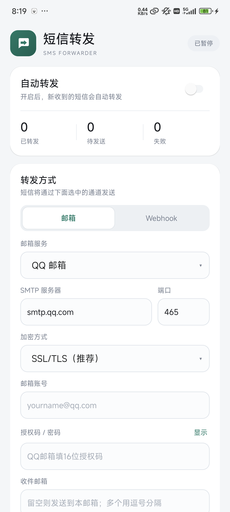
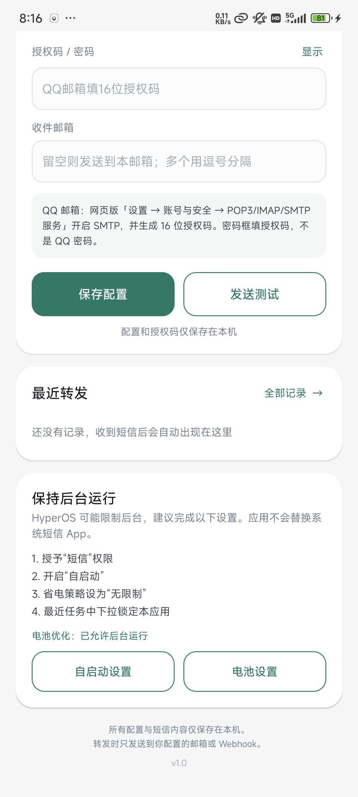

# 短信转发（SMS Forwarder）

一个只在本机处理短信的 Android 小应用：监听新短信，按配置转发到 **邮箱（SMTP）** 或 **HTTPS Webhook**。

支持 **Android 8.0 – 16**（minSdk 26 / targetSdk 34），已在小米 Redmi Note 14 5G / Android 14 / HyperOS 上完成真机验证；不替换系统短信 App，也不读取历史短信。



## 为什么首选邮箱 / QQ 邮箱

- **QQ 私聊没有面向普通开发者的官方主动推送接口。** 走非官方 QQ 协议需要逆向登录态，存在封号和账号安全风险，不适合放在常驻的手机上。
- **QQ 邮箱 SMTP 是官方支持的第三方发信方式。** 在 QQ 邮箱网页版开启 SMTP、生成 16 位授权码后，App 就能把短信作为邮件发到你的 QQ 邮箱；QQ 邮箱 App 会正常提醒。需要的话还可以在 QQ 中开启“QQ邮箱提醒”。
- **邮件不依赖某个第三方推送服务。** 换手机、换邮箱服务商都能用；配置只在本机。
- **Webhook 留给进阶用法。** 如果你有服务器、n8n、Node-RED，或想把短信再转到企业微信/飞书/Telegram，可以用通用 JSON Webhook。

> 本 App 不实现 QQ 私聊协议。它做的是「短信 → QQ 邮箱」，不是「短信 → QQ 聊天窗口」。

## 功能

- 监听 `SMS_RECEIVED`，支持长短信（多段拼接）
- 邮箱通道：QQ 邮箱、163、Gmail、Outlook、自定义 SMTP
  - SSL/TLS（常用 465）和 STARTTLS（常用 587）
  - 发件人、收件人均可配置；收件人留空时默认发给自己
  - 正文包含发件人、接收时间、设备型号和完整短信内容
- Webhook 通道：HTTPS POST JSON，可接自建服务/自动化
- 本地队列 + `JobScheduler` 重试（最多 5 次，指数退避）
- 最近记录、发送状态、失败原因、手动重试、复制正文
- 授权码使用 Android Keystore AES-256-GCM 加密存储；关闭系统备份
- 不申请 `READ_SMS`，不读取历史短信
- 国产 ROM 自启动页快捷入口：小米/HyperOS、华为/荣耀、OPPO/一加/realme、vivo/iQOO、三星、魅族、华硕；未命中时回退到应用信息页
- Android 15/16 侧载应用的短信权限受限提示与解锁指引

## 兼容性

| 项目 | 支持情况 |
|---|---|
| Android 版本 | 8.0 – 16（API 26–36） |
| 已真机验证 | Redmi Note 14 5G / Android 14 / HyperOS |
| 其他 Android 手机 | 使用标准 `SMS_RECEIVED`、`JobScheduler`、SMTP/HTTPS，无厂商私有依赖；厂商后台限制按 App 内提示设置 |
| Android 15/16 | 系统对侧载应用的短信权限增加了“受限制的设置”保护，App 会检测并引导解锁 |
| 默认短信 App | 不需要，也不会替换系统短信 App |
| 平板/折叠屏 | 布局会随宽度换行，未专门验证平板体验 |

> 没有在每一家厂商的机器上逐一实测。代码只使用 AOSP 公开 API，不依赖 MIUI/华为/OPPO 的私有权限；不同 ROM 的差异主要在「后台保活」和「自启动」入口，App 已做快捷跳转与回退。



## 安装与首次配置

从 GitHub Releases 下载 `SmsForwarder-release.apk`，或在本地构建后使用 `dist/SmsForwarder-release.apk`。

1. 打开 App，点「去授权」，在系统弹窗选择「始终允许」（短信权限）。
   - Android 15/16 若权限是灰色：先到应用信息 → 右上角 ⋮（更多）→「允许受限制的设置」，再开启短信权限。App 会给出同样的指引。
2. 「转发方式」选择「邮箱」。
3. 「邮箱服务」选择「QQ 邮箱」，服务器会自动填成 `smtp.qq.com:465`、`SSL/TLS`。
4. 填写：
   - **邮箱账号**：完整的 QQ 邮箱地址，例如 `12345678@qq.com`
   - **授权码 / 密码**：QQ 邮箱的 **16 位授权码**，不是 QQ 登录密码
   - **收件邮箱**：可以留空（默认发给自己），也可以填另一个邮箱
5. 点「发送测试」。收到测试邮件后，再点「保存配置」。
6. 打开「自动转发」开关。状态变成「监听中」即可。
7. 按 App 内「保持后台运行」的提示完成厂商设置：
   - 自启动：允许
   - 省电策略：无限制
   - 最近任务中下拉锁定本应用

不同厂商的菜单名称可能是「自启动」「后台活动」「允许后台运行」「电池 → 无限制」等；App 的「自启动设置」会优先打开对应厂商页面，找不到时回退到应用信息。

### 获取 QQ 邮箱授权码

在电脑上登录 QQ 邮箱网页版：

**设置 → 账号与安全 → POP3/IMAP/SMTP/Exchange/CardDAV/CalDAV 服务 → 开启 SMTP 服务 → 按提示验证密保 → 获得 16 位授权码**

官方说明：<https://help.mail.qq.com/detail/0/1087>

授权码只显示/生成一次，请妥善保存。若泄露，可在 QQ 邮箱的「授权码管理」中停用或重置。

## Webhook 格式

请求：

```http
POST https://your-server.example/sms
Content-Type: application/json; charset=utf-8
```

Body：

```json
{
  "event": "sms.received",
  "from": "10086",
  "text": "您的验证码是 123456",
  "received_at": "2026-11-08T20:00:00+08:00",
  "device": "Xiaomi 24069RA21C",
  "android": "14",
  "message_id": 12
}
```

「发送测试」会发送 `event: "sms.test"`。

安全限制：只接受 `https://`。本机调试允许 `http://127.0.0.1` / `http://localhost`（方便 `adb reverse` 联调），其他明文 HTTP 会被拒绝。

## 安全与隐私

- 短信内容和发送记录只保存在本机 SQLite；已发送/失败记录保留 30 天，最多 500 条，待发送记录不会被清理。
- SMTP 授权码用 Android Keystore 的 AES-256-GCM 加密后写入 `SharedPreferences`，不进入 Android 备份。
- 不集成统计 SDK、不请求无关权限、不向第三方服务器上报。
- 短信只会发送到你配置的 SMTP 服务器或 Webhook。
- 短信常含验证码，建议使用独立邮箱/应用专用授权码；手机丢失时及时停用 QQ 邮箱授权码。
- 应用不会拦截、删除或修改系统短信，也不会替换默认短信 App。

## 构建

环境：JDK 17+、Android SDK（build-tools + platform）、Python 3。脚本会自动寻找 PyCharm/Android Studio 自带 JBR。

```powershell
# Release APK（默认）
powershell -ExecutionPolicy Bypass -File .\build.ps1

# Debug APK（带仅用于测试的 DebugSmsReceiver，不用于日常）
powershell -ExecutionPolicy Bypass -File .\build.ps1 -DebugBuild

# 构建并安装到已连接的手机
powershell -ExecutionPolicy Bypass -File .\build.ps1 -Install
```

输出：

- `dist/SmsForwarder-release.apk`
- `dist/SmsForwarder-debug.apk`

签名文件在 `signing/`。**升级安装必须使用同一个签名文件**；不要删除或外传该目录。仓库的 `.gitignore` 已排除 `signing/`、`build/`、`dist/`。

## 发布到 GitHub

本目录已经初始化为 Git 仓库并完成首个提交（`Initial release: SMS Forwarder for Android`）。直接添加远端即可：

```bash
git remote add origin git@github.com:<你的用户名>/<仓库名>.git
git push -u origin main
```

如果是从压缩包/裸文件重新开始：

```bash
git init -b main
git add .
git commit -m "Initial release: SMS Forwarder for Android"
git remote add origin git@github.com:<你的用户名>/<仓库名>.git
git push -u origin main
```

然后在 GitHub 创建 Release，上传 `dist/SmsForwarder-release.apk`。不要提交 `signing/` 或包含授权码的配置。

`.github/workflows/build.yml` 会在 push / PR 时用 Windows runner 构建 APK 作为 CI 产物。CI 使用临时签名，**只用于验证能编译**；正式发布包请在本机用 `signing/` 里的固定密钥构建，否则不同构建之间无法覆盖升级。

## 已验证 / 未验证

已在当前手机上验证：

- App 安装、启动、UI、权限申请
- **真实运营商短信 → 入队 → 邮箱 SMTP 发送成功**（真机端到端，截图和日志中的号码/邮箱已脱敏，不进入仓库）
- Webhook：真实 HTTP POST、JSON 编码、中文正文
- SMTP：连接 `smtp.qq.com:465`、TLS 握手、AUTH LOGIN（用错误授权码验证了错误提示）
- 短信解析：用合法 GSM SMS-DELIVER PDU 走真实 `SmsReceiver` 代码路径，正确解析发件人/正文并入队
- 后台任务：断网时入队失败，恢复网络后自动重试并成功
- 邮件/网页测试按钮、日志、状态统计

未验证：

- 其他厂商真机（华为/荣耀、OPPO/一加/realme、vivo/iQOO、三星等）的实际后台保活表现
- Android 8.0–13 和 Android 15/16 的逐版本真机回归（代码按 minSdk 26 编译，Android 15/16 权限指引已实现）
- 平板/折叠屏专门布局

## 已知限制

- 只转发 SMS，不处理 MMS/彩信。
- App 不是默认短信 App；如果系统把应用强行停止，广播不会送达，需要允许自启动并在最近任务中锁定。
- Android 15/16 侧载应用的短信权限受“受限制的设置”保护，首次授权需要按 App 内指引多操作一步。
- 不同厂商的“自启动/后台”页面可能改版，App 的快捷入口找不到时会回退到应用信息页。
- 邮件发送受 SMTP 服务商频率限制；QQ 邮箱对群发/高频邮件有风控。
- 手机长时间离线时，队列最多重试 5 次；之后可在记录详情里手动重试。
- Webhook 不校验响应体，只认 2xx；不会跟随重定向。

## 目录

```
sms-forwarder/
  AndroidManifest.xml
  build.ps1
  res/                  # 原生 XML 布局与资源
  java/com/hp/smsforward/
    MainActivity.java
    LogsActivity.java
    SmsReceiver.java
    ForwardJobService.java
    DeviceSettings.java  # 各厂商自启动/电池设置入口
    Config.java
    Db.java
    SecurePrefs.java
    SmtpClient.java
    EmailForwarder.java
    WebhookForwarder.java
  docs/screenshots/     # 不含个人信息的界面截图
  .github/workflows/    # CI 构建
  tools/                # 仅测试用：本地 Webhook sink / PDU 生成器
  signing/              # 本机签名密钥（git 忽略，勿删）
  dist/                 # 本机构建产物（git 忽略）
```

## License

MIT，见 [LICENSE](LICENSE)。隐私说明见 [PRIVACY.md](PRIVACY.md)。
